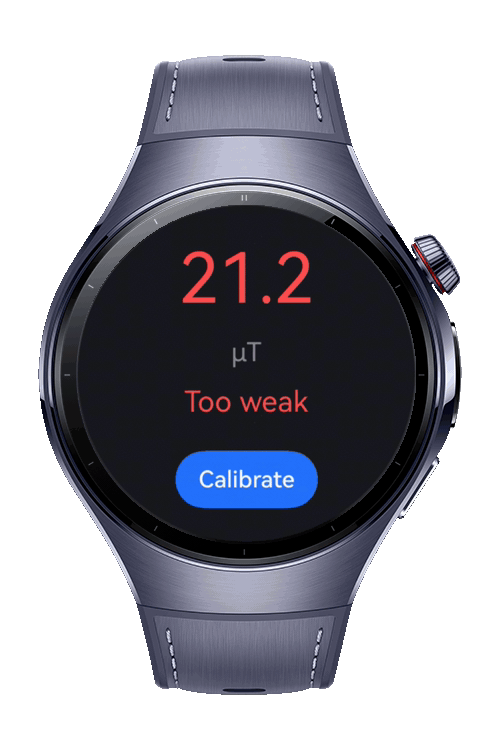
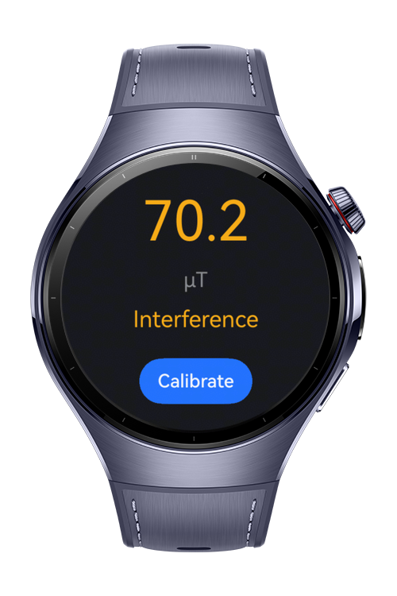
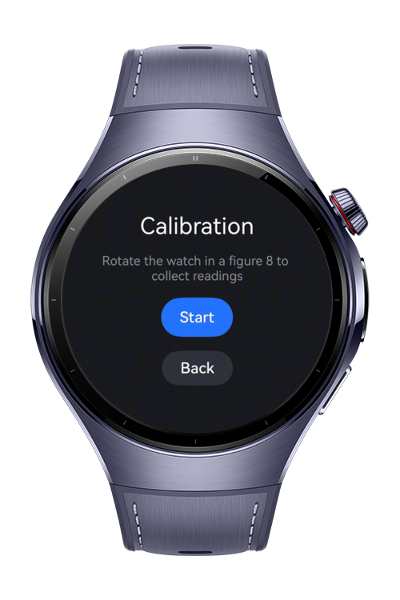

> **Note:** To access all shared projects, get information about environment setup, and view other guides, please visit [Explore-In-HMOS Index](https://github.com/Explore-In-HMOS/hmos-index).

# How To Use Magnetometer

This application(how-to-use-magnetometer) shows you how to read the magnetic field sensor on a HarmonyOS wearable device and interpret the
readings. It measures the total field strength in microtesla, indicates whether the surrounding magnetic environment is
normal or disturbed.

# Preview

<div>
    
    
    
</div>

# Use Cases

- Measure the total magnetic field strength around the device in real time.
- Detect magnetic interference that would make a compass unreliable.
- Calibrate the magnetometer with a figure 8 motion to compensate for offset.

# Tech Stack

- **Languages**: ArkTS
- **Frameworks**: HarmonyOS SDK 5.1.1(19)
- **Tools**: DevEco Studio Version 6.1.1.280
- **Libraries**: @kit.SensorServiceKit, @ohos.data.preferences

# Directory Structure

```
└── main
    └── ets
        └── entryability
            ├── EntryAbility.ets
        └── entrybackupability
            ├── EntryBackupAbility.ets
        └── pages
            ├── Calibrate.ets
            ├── Index.ets
    └── resources
        └── base
            └── element
                ├── color.json
                ├── float.json
                ├── string.json
            └── media
                ├── background.png
                ├── foreground.png
                ├── layered_image.json
                ├── startIcon.png
            └── profile
                ├── backup_config.json
                ├── main_pages.json
        └── dark
            └── element
                ├── color.json
        └── rawfile
    └── module.json5
```

# Constraints and Restrictions

## Supported Devices

- Huawei Watch 5

# License

**How-to-use-magnetometer** is distributed under the terms of the MIT License
See the [LICENSE](./LICENSE) for more information.